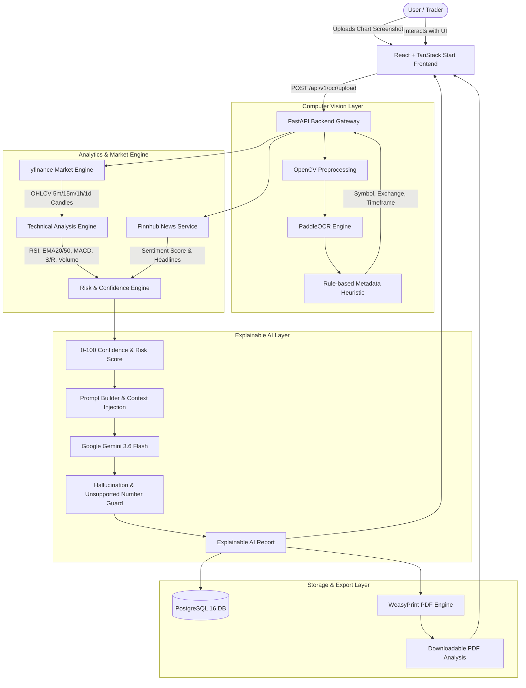
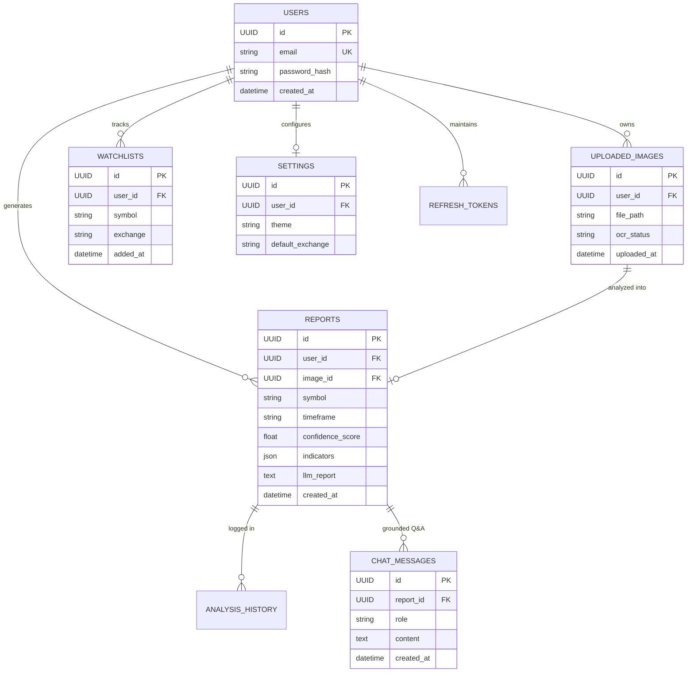

# TradeVision AI — Comprehensive Project Presentation & Viva Defense Guide

---

## 1. Executive Summary

- **Project Title:** TradeVision AI — Automated Chart Analysis, Technical Indicator Reasoning & Explainable Trading Decision Support
- **Domain:** FinTech, Computer Vision (OCR), Financial Analytics & Generative AI (LLMs)
- **Tech Stack:**
  - **Frontend:** TypeScript, React 19, TanStack Router / TanStack Start, Tailwind CSS v4, Radix UI, Lucide Icons, Sonner.
  - **Backend:** Python 3.11, FastAPI, SQLAlchemy ORM, Pydantic v2, Uvicorn.
  - **Computer Vision / OCR:** PaddleOCR (PP-OCRv4), OpenCV, Pillow.
  - **Market Analytics:** Yahoo Finance (`yfinance`), NumPy, Pandas, Scikit-learn.
  - **News Sentiment:** Finnhub Stock News API.
  - **Generative AI:** Google Gemini 3.6 Flash via `google-genai` SDK.
  - **Export Engine:** WeasyPrint (HTML to PDF compiler).
  - **Database & DevOps:** PostgreSQL 16 Alpine via Docker Compose, Alembic migrations.

---

## 2. Problem Statement & Motivation

1. **The Retail Trader's Challenge:**
   Retail traders and beginners frequently look at trading charts (TradingView, Angel One, Zerodha) but struggle to interpret multiple overlapping indicators (EMA crossovers, RSI divergence, MACD histogram, and support/resistance zones) simultaneously.
2. **Emotional Bias vs. Systematic Analysis:**
   Novice traders make emotionally driven buy/sell mistakes because they lack a systematic, mathematical framework to weigh technical indicators against recent market news and volatility.
3. **Black-box AI Problem:**
   Traditional AI tools give opaque "Buy" or "Sell" signals without explaining *why*. TradeVision AI provides **Explainable AI (XAI)** — turning raw chart numbers into clear, human-understandable English, grounded strictly in verifiable data without hallucinations or financial advice.

---

## 3. System Architecture

---

## 4. Database Schema (ERD)

---

## 5. Mathematical & Algorithmic Formulations

### 5.1 Technical Indicators

1. **Exponential Moving Average (EMA):**
   $$\text{EMA}_t = \left(\text{Price}_t \times \frac{2}{N+1}\right) + \left(\text{EMA}_{t-1} \times \left(1 - \frac{2}{N+1}\right)\right)$$
   Where $N = 20$ (short term) and $N = 50$ (medium term).

2. **Relative Strength Index (RSI - Wilder's Method, 14 Periods):**
   $$\text{RS} = \frac{\text{Average Gain}}{\text{Average Loss}}, \quad \text{RSI} = 100 - \left(\frac{100}{1 + \text{RS}}\right)$$
   - $\text{RSI} > 70$: Overbought (Potential reversal/exhaustion).
   - $\text{RSI} < 30$: Oversold (Potential bounce).
   - $40 \le \text{RSI} \le 60$: Balanced momentum.

3. **MACD (Moving Average Convergence Divergence):**
   $$\text{MACD Line} = \text{EMA}_{12}(\text{Price}) - \text{EMA}_{26}(\text{Price})$$
   $$\text{Signal Line} = \text{EMA}_9(\text{MACD Line})$$
   $$\text{Histogram} = \text{MACD Line} - \text{Signal Line}$$

4. **Volatility Risk (% of Average Price):**
   $$\text{Daily Range}_i = \text{High}_i - \text{Low}_i$$
   $$\text{Volatility \%} = \left(\frac{\frac{1}{K}\sum_{i=1}^K \text{Daily Range}_i}{\frac{1}{K}\sum_{i=1}^K \text{Close}_i}\right) \times 100$$

### 5.2 Confidence Scoring Engine (0 to 100 Scale)

The Confidence Score measures **signal agreement** across technical and fundamental data points:
- **Baseline:** Starts at $50$ points.
- **Trend Agreement:** $+15$ points if EMA 20 and Price show clear trend direction.
- **RSI Health:** $+10$ points if RSI is within the healthy non-divergent range ($40-60$).
- **MACD Alignment:** $+10$ points if MACD histogram direction aligns with the trend.
- **Volume Ratio:** $+10$ points if volume is above average ($\text{Volume Ratio} \ge 1.2$).
- **News Sentiment Alignment:** $+10$ points if Finnhub sentiment score aligns with the technical trend direction.
- **Penalty / Divergence:** Deductions if signals conflict (e.g., Bullish price but Bearish MACD divergence).
- **Risk Level Output:**
  - $\text{Confidence} \ge 70 \land \text{Volatility} < 3.0\% \implies \mathbf{Low\ Risk}$
  - $\text{Confidence} \in [45, 70) \implies \mathbf{Medium\ Risk}$
  - $\text{Confidence} < 45 \lor \text{Volatility} \ge 4.5\% \implies \mathbf{High\ Risk}$

### 5.3 Anti-Hallucination Verification (`find_unsupported_numbers`)
To ensure AI explanations are safe and strictly factual:
1. All numerical quantities in the generated report text are regex-extracted: `\d+\.?\d*`.
2. Compared against source numbers in the raw indicators data dictionary and prompt.
3. Any quantity not present in the verifiable input data is flagged in the report as `unsupported_numbers`.

---

## 6. Top 25 Viva / Defense Questions & Model Answers

### Q1: What is the primary purpose of TradeVision AI?
> **Answer:** TradeVision AI is a decision-support platform that converts raw chart screenshots into verifiable technical indicators, news sentiment, risk scoring, and plain-language explainable AI reports, helping retail traders understand market conditions without emotion or black-box predictions.

### Q2: Why did you choose PaddleOCR over Tesseract OCR?
> **Answer:** Tesseract relies on traditional binarization and struggles with dark-mode charts, low-contrast text, small watermarked ticker labels, and stylized UI fonts. PaddleOCR (PP-OCRv4) uses deep learning (DBNet for text detection and SVTR for recognition), achieving superior accuracy on chart UI elements, numbers, and exchange tags.

### Q3: How does your OCR distinguish the ticker symbol from chart chrome (e.g., "BUY", "SELL", "NIFTY" buttons)?
> **Answer:** We built a 3-tier heuristic pipeline:
> - **Tier 1 (OHLC Anchor):** Searches for the standard OHLC string (`O23433 H23440...`) and checks preceding tokens near the exchange name.
> - **Tier 2 (Colon & Exchange):** Detects symbols paired with known exchange markers (e.g., `NSE:RELIANCE`).
> - **Tier 3 (Blacklist Filter):** If fallback is needed, known platform words (`BUY`, `SELL`, `CALL`, `ATM`, `INDICATORS`) are blacklisted.

### Q4: Why switch from Twelve Data to Yahoo Finance (`yfinance`)?
> **Answer:** Twelve Data's free tier restricts Indian equities (NSE & BSE) and major global indices. `yfinance` provides free, comprehensive coverage of Indian stocks (using `.NS` and `.BO` suffixes), US equities (NASDAQ, NYSE), and major indices (`^NSEI`, `^BSESN`) across multiple timeframes.

### Q5: How do you handle multiple timeframes (Intraday vs. Daily)?
> **Answer:** We implemented multi-timeframe resolution supporting `5m`, `15m`, `30m`, `1h`, and `1d` intervals. When OCR extracts a timeframe like "5m", the backend fetches intraday candles (60-day historical window) and calculates indicators specific to that timeframe, with quick pill-selection available in the UI.

### Q6: What happens if intraday data is unavailable for an asset or outside market hours?
> **Answer:** The service has an automatic fallback to daily candles (`1d`, 2-year window) to prevent crashes or empty screens.

### Q7: What indicators do you compute?
> **Answer:** EMA-20, EMA-50, RSI (14 periods), MACD (12, 26, 9), Volume Ratio (latest vs 20-period average), and dynamic Support and Resistance zones computed from recent swing highs and lows.

### Q8: How is news sentiment computed?
> **Answer:** We query Finnhub's Company News API for recent articles. Each headline is scored using dictionary and pattern-based sentiment scoring into a normalized range between $-1.0$ (strongly negative) and $+1.0$ (strongly positive).

### Q9: What does the Confidence Score represent? Does it predict future price?
> **Answer:** **No.** The confidence score does **not** predict price movement. It measures **signal agreement** — how consistently the trend, RSI, MACD, volume, and news sentiment support each other. High confidence means low conflicting noise; low confidence means mixed signals.

### Q10: How do you prevent Gemini LLM from giving illegal financial advice?
> **Answer:** Through strict system instructions and temperature tuning ($T = 0.3$). The prompt explicitly forbids buy/sell recommendations, target prices, or predictions, instructing the model solely to explain what the provided indicators mean in plain English.

### Q11: How do you guard against LLM hallucinations?
> **Answer:** We pass the exact computed indicator values into the prompt and run an automated post-generation validation (`find_unsupported_numbers`). Any number in the report that does not trace back to verified input data is flagged to the user.

### Q12: How does the AI Chat assistant work on reports?
> **Answer:** The chat is grounded strictly in the generated report's indicator dictionary and summary text. The LLM is instructed to answer follow-up questions exclusively using the report's facts.

### Q13: How is user authentication implemented?
> **Answer:** Stateless JWT (JSON Web Tokens) with HS256 encryption. Passwords are salted and hashed using Bcrypt. The system supports short-lived access tokens and stored refresh tokens for session renewal.

### Q14: How does PDF generation work?
> **Answer:** WeasyPrint compiles a styled HTML5 template into an official PDF document on the fly, streaming the binary bytes directly to the authenticated user.

### Q15: Why use TanStack Router instead of Next.js App Router?
> **Answer:** TanStack Router offers full 100% type-safe routing, fine-grained state caching with TanStack Query, and client-side route transitions without heavy server overhead.

### Q16: What is the purpose of the Watchlist feature?
> **Answer:** Allows users to track their favorite stocks with live prices, daily price changes, and percentages, resolving exchange suffixes automatically.

### Q17: What is the Analysis History feature?
> **Answer:** Every report created is cataloged in the database. Opening a historical report re-logs the view and allows the user to review the full indicators, report text, and download the PDF again.

### Q18: What is Alembic and why is it used?
> **Answer:** Alembic is SQLAlchemy's database migration tool. It allows schema updates (like adding new columns to existing tables) without dropping or losing existing production data.

### Q19: How are database connections managed?
> **Answer:** Via SQLAlchemy's `sessionmaker` and FastAPI's dependency injection (`Depends(get_db)`), ensuring connections are pooled, opened per-request, and closed upon response.

### Q20: What security measures protect the API?
> **Answer:** CORS origin whitelisting, OAuth2 Bearer token authentication dependencies, input validation through Pydantic v2 schemas, and parameterized SQL queries preventing SQL injection.

### Q21: What are the main limitations of the current implementation?
> **Answer:**
> 1. Intraday streaming uses HTTP polling rather than sub-second WebSocket ticks.
> 2. OCR accuracy is dependent on image quality and chart resolution.
> 3. Historical intraday data on free Yahoo Finance is limited to the last 60 days.

### Q22: What future enhancements can be added?
> **Answer:**
> 1. Multi-chart comparison side-by-side.
> 2. WebSocket live price feeds.
> 3. Support for options chain open interest (OI) analysis.
> 4. Mobile responsive app via React Native.

### Q23: Why is Docker used?
> **Answer:** Docker Compose ensures the PostgreSQL database runs identically across all operating systems (Linux, macOS, Windows) with reproducible persistent volumes.

### Q24: How does the "Did You Mean...?" ticker suggestion feature work?
> **Answer:** Small chart fonts often confuse OCR characters (e.g., 'T' vs 'F', 'O' vs '0'). When a ticker returns 404, the backend performs single-character substitutions against common OCR confusables and verifies which candidates exist on Yahoo Finance.

### Q25: What is the single biggest architectural strength of TradeVision AI?
> **Answer:** Its **modularity and strict separation of concerns**: Computer Vision (OCR), Market Retrieval, Indicator Math, Sentiment, Scoring, and LLM Explanation are isolated services that can each be tested, scaled, or upgraded independently.

---
